# Self-calibrating thermal NUC + deterministic-latency motion detection

**An FPGA pipeline for a thermal camera that removes the sensor's fixed-pattern noise _without a calibration shutter_, repairs dead and hot pixels, finds moving people and reports the result a _fixed number of clock cycles_ after every frame. It runs on a Terasic DE10-Standard (Cyclone V SoC), fed with real thermal footage by the board's ARM core.**

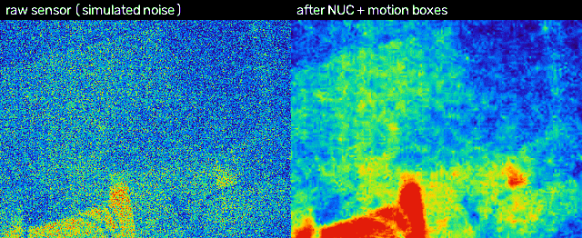

*Recorded from the board. Left: the footage after the on-chip sensor emulator has added fixed-pattern noise, stripes, grain and dead/hot pixels. Right: after the FPGA's scene-based NUC and bad-pixel repair, with the motion detector's boxes (green). The footage is real ([CDnet 2014](docs/datasets.md) thermal); the sensor noise is simulated.*

| | measured on the DE10-Standard |
|---|---|
| End of frame to box list | **8,724 clock cycles = 349 us, min = max over 69,510 frames** (zero jitter) |
| Picture read back from the board vs the Python model | **identical in all 76,800 pixels** (build 5, frame 7,730 after reset) |
| ARM writes one 320x240 frame into the FPGA | 10.9 ms through the HPS bridge (a 60 Hz frame lasts 16.7 ms) |
| Person boxed, 5 real clips (50 frames each) | 91 to 96 % of the frames that contain a person |
| FPGA use | 8,575 ALMs (20 %), 31 DSP blocks, **551 of 553 RAM blocks**, timing met at all corners |

**Status (2026-10-29).** Builds 2 and 5 (JTAG host bus) and build 6 (ARM feeder, from the SD card) run on the board. The numbers above are labelled with the build they come from in [Results](#results). Limits are listed [at the end](#limits-and-honest-notes).

## Contents
[Architecture](#architecture) | [Live demo: five clips](#live-demo-recorded-from-the-board) | [Why every clip starts with 5 seconds of an empty scene](#why-every-clip-starts-with-about-5-seconds-of-an-empty-scene) | [How a clip gets into the FPGA](#how-a-clip-gets-into-the-fpga) | [Results](#results) | [Run it yourself](#run-it-yourself) | [Repository](#repository) | [Limits](#limits-and-honest-notes)

## Architecture

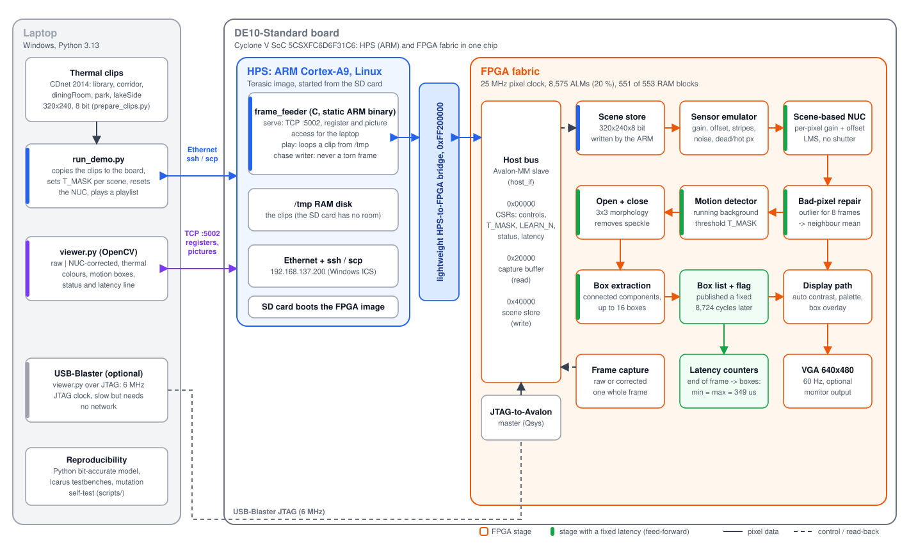

* **Laptop** prepares the clips, copies them to the board and shows the result (`host/run_demo.py`, `host/viewer.py`). It talks to the board over Ethernet; an optional USB-Blaster path reads the same registers over JTAG.
* **HPS (the ARM core, Linux)** runs `sw/frame_feeder`: it plays a clip by writing each frame through the lightweight HPS-to-FPGA bridge into the FPGA's scene store, and serves registers and pictures to the laptop on TCP port 5002.
* **FPGA** holds the whole pipeline: a scene store written by the ARM, a **sensor emulator** (there is no thermal camera in this project), the **scene-based NUC**, bad-pixel repair, a running-background **motion detector**, 3x3 open/close, single-pass **box extraction**, a VGA display path and a one-frame **capture buffer** the host can read. The stages shown with a green bar are feed-forward with fixed depth, which is why the latency is constant.

| Stage | How |
|---|---|
| Sensor (demo) | `sensor_emu`: a host-written 8-bit frame store (or, in build 5, a background ROM plus 3 moving warm rectangles) with per-pixel gain/offset errors, column stripes, temporal noise and dead/hot pixels from an integer hash; bit-exact Python twin ([noise model and its limits](docs/noise_model.md)) |
| NUC | per pixel `y = g*(x - o)`; each frame `o` and `g` move a small step toward the mean of the 4 neighbours (LMS); the error is clipped to 3x its frame mean; gain learning only when the scene moves (activity gate); a learning window (`LEARN_N`, default 256 frames) stops it absorbing a static scene |
| Bad pixels | outside the neighbour range by more than 800 counts, or stuck at a rail, for 8 frames: replaced by the mean of the valid neighbours |
| Motion | running-average background (warm start), threshold `T_MASK` (a run-time register, default 400 counts), 3x3 open + close, single-pass connected components: up to 16 boxes |
| Display | 640x480 VGA, raw / corrected / split view, gray or iron palette, auto contrast, green boxes |
| Host bus | CSRs, a one-frame capture buffer and the scene store behind one Avalon-MM slave; the JTAG-to-Avalon master and the HPS lightweight bridge both drive it |

## Live demo (recorded from the board)

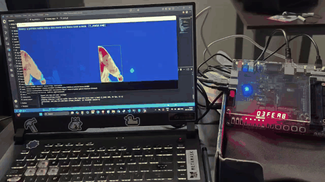

*The whole setup, filmed with a phone: the laptop shows the viewer (`host/run_demo.py`) while the DE10-Standard beside it runs the design from its SD card and the HEX display counts frames. The laptop's picture is read back from the FPGA over Ethernet; no VGA monitor is used.*

How to read the pictures: **left** is what the simulated sensor delivers (raw), **right** is what the FPGA makes of it, with the motion boxes. The colours are applied on the laptop: one fixed contrast window per GIF maps the cold background to purple-blue and warm things through green and yellow to orange and red, like the rainbow palette of a thermal camera. The GIFs start after the warm-up (next section). Each GIF frame is 5 source frames, played at the footage's assumed 30 frames per second.

### library: a person walks into a dim room and leans over a desk


`T_MASK` 640. The easiest clip: a large, warm person against a cold, static room. On the board the boxes covered 94 % of the person frames and 91 % of the person's pixels.

### corridor: a person walks towards the camera

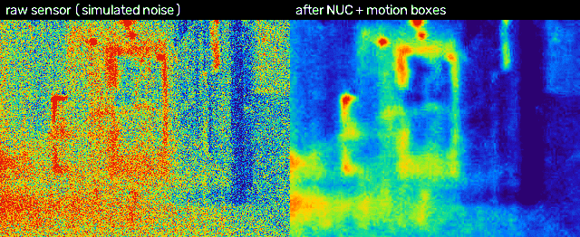

`T_MASK` 400. The person grows from a few pixels to filling the frame. Covered: 91 % of the frames, 84 % of the pixels. The NUC output is visibly softer than the source (see [limits](#limits-and-honest-notes)).

### diningRoom: people walk past

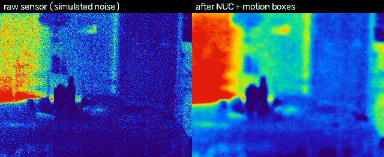

`T_MASK` 200. Two people, close to the camera, in a room with a warm window on the left. Covered: 95 % of the frames, 94 % of the pixels. Small false boxes appear now and then near the ceiling lamp (3 of the 4 person-free frames in this sample had one).

### park: people walk across outdoors

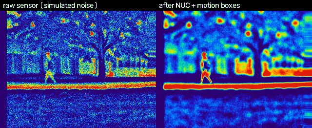

`T_MASK` 256. Small figures, a busy background (trees, a warm path). Covered: 96 % of the frames, 89 % of the pixels. The corrected picture shows horizontal streaks near its right edge; they come from the NUC and I have not investigated them.

### lakeSide: tiny distant people, low contrast

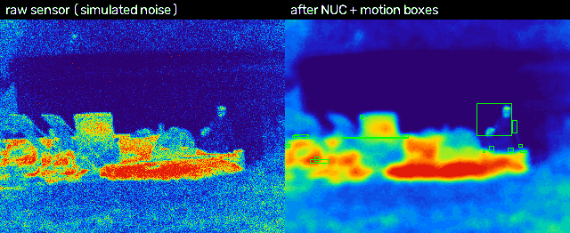

`T_MASK` 96 (at the default 400 the detector would miss almost everything: F1 0.22 against 0.57). The people are 15 to 20 pixels tall. At least one box lands on a person in 94 % of the frames, but the boxes cover only 62 % of the person pixels. This is the clip where the design is weakest.

### Boxes from the board against the ground truth

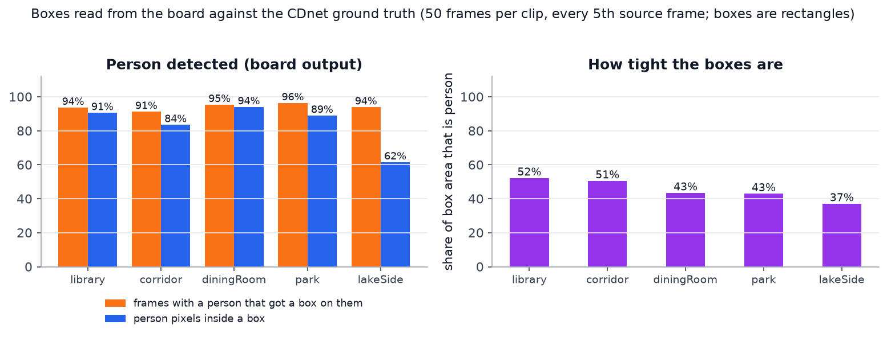

For each clip the 50 frames of its GIF were compared with the CDnet pixel-level ground truth: a frame counts as detected if a box covers at least 20 % of the person's pixels. The boxes are bounding rectangles, so only 37 to 52 % of their area is person; that is how a bounding box works, not a measurement error. This is a 50-frame sample per clip taken with the board stepped one frame at a time ([how](#how-the-gifs-were-recorded)); the full-sequence scores are in [Results](#results).

## Why every clip starts with about 5 seconds of an empty scene

Every clip in `data/clips` begins with **about 150 frames (5 s at 30 fps) with nobody in the picture**, and the person appears afterwards. This is deliberate. The pipeline learns what the scene looks like and has to be allowed to settle before its output means anything:

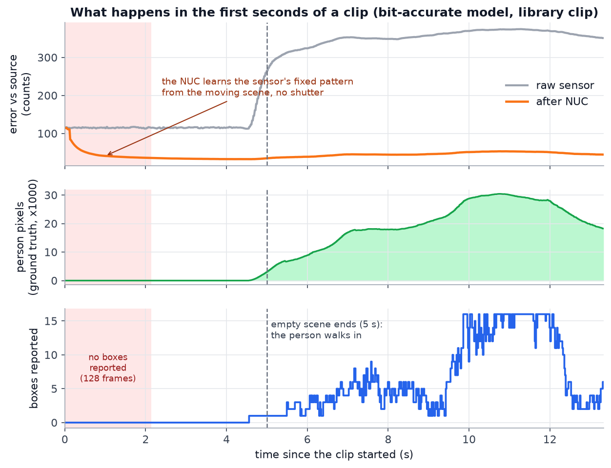

1. **The NUC starts from nothing.** At the start of each clip the demo clears the NUC coefficients and the detector (`PULSE` register). With no calibration shutter the NUC learns the sensor's fixed pattern from the scene itself. In the model run above the error against the clean picture falls from about 115 to 40 counts within a second.
2. **The detector refuses to report during its first 128 frames** (`DET_WARM`, about 2.1 s, the red band). Until then its running-average background is not trustworthy, and anything it reported would be noise.
3. **The background must see the empty room.** The detector compares every pixel with a running average of that pixel. If a person were already in the picture at the start, the average would contain them and they would be treated as background (the "ghost" problem). Five seconds of empty scene gives the average time to settle first, with margin over the 2.1 s minimum.
4. **The NUC stops learning after `LEARN_N` = 256 frames** so that it cannot absorb a static scene ([bug log 18 and 19](docs/bug_log.md)). It must therefore have learned the sensor pattern by then, from the clean start.

In the model run the first box appears at 4.6 s, when the person walks in; the ground truth has them at 4.7 s. The same thing happens at every clip change in the playlist demo, because the NUC and detector are reset for each clip. The GIFs on this page were recorded after the warm-up frames had been played, so they begin just before the person arrives; `run_demo.py` shows the warm-up in full. The `park` clip is the exception: a person is already walking at frame 0, so its detector learns with a person in view.

## How a clip gets into the FPGA

```
laptop: clip.u8 (320x240, 8 bit)
   --scp--> board /tmp (RAM disk)
   frame_feeder play (ARM) --19,200 x 32-bit writes per frame, lightweight bridge--> FPGA scene store
   FPGA: scene store -> sensor emulator (adds the simulated sensor noise) -> NUC -> detector -> boxes -> VGA
   laptop viewer <--TCP :5002-- frame_feeder serve <--read: capture buffer, boxes, status-- FPGA
```

There is room for only one frame in the FPGA (the RAM blocks are full), so a frame must be replaced while the scan is reading it, without ever showing half of two frames. The writer therefore **follows the scan row by row**: it watches a hardware row counter (`FEED_ROW`), overwrites row r only after the scan has read it, and finishes before the scan returns to row r one frame later:

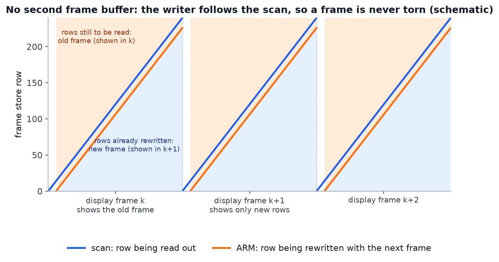

This is proven on the full-size RTL (`sys_feed` test: the frame in which the content switches is entirely the new frame, 0 of 76,800 pixels differ from the model; an old-only frame would differ in 73,693) and an independent mock of the ARM side. On the board a frame takes 10.9 ms to write, so the writer keeps up with the 16.7 ms frame; if it ever falls behind, the feeder flags the frame as torn (about 0.8 % of frames during streaming, about 1.5 % while the viewer reads at the same time).

## Results

### The NUC removes fixed-pattern noise without a shutter

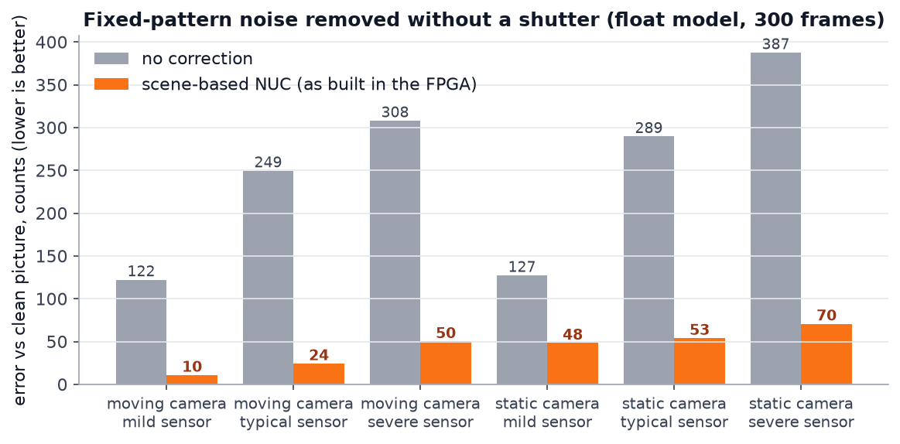

Float model of the NUC variant built in hardware (the RTL is verified bit for bit against an integer model of the same algorithm), 300 frames, error measured after a global affine alignment. The error falls by a factor of 6 to 11 for a moving camera and 2.6 to 5.5 for a static one. A static camera is the harder case: the scene itself does not move, so the NUC cannot tell scene from sensor pattern and over-smooths; the learning window limits that ([bug log 18, 19](docs/bug_log.md)). Study: [`docs/results/nuc_study.md`](docs/results/nuc_study.md).

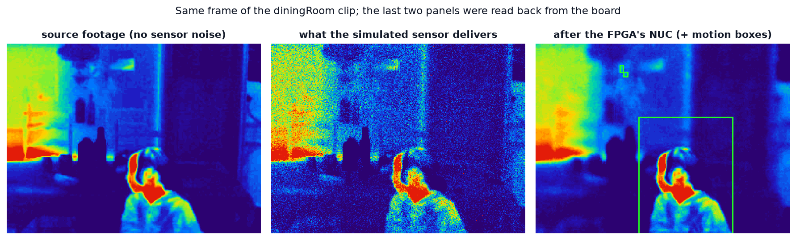

The same frame of the diningRoom clip in three states. The last two panels were read back from the board. The NUC output is clean but softer than the source.

### The detector works on real thermal footage, and does not need the NUC

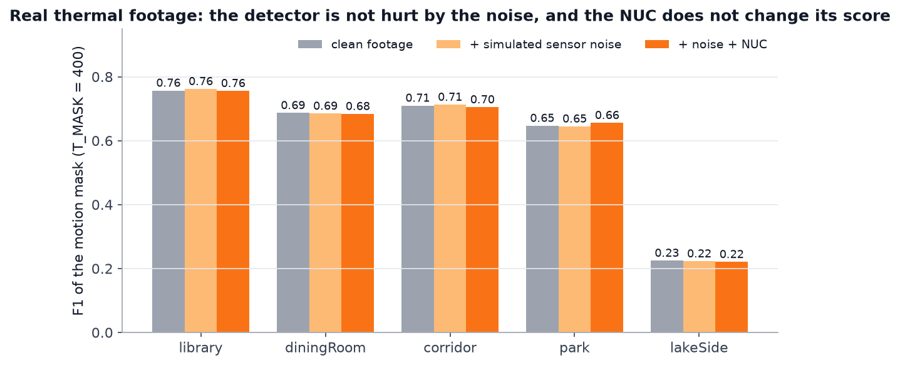

Bit-accurate model on the CDnet 2014 thermal sequences, CDnet scoring rules, `T_MASK` = 400, up to 600 scored frames after 300 warm-up frames ([`docs/results/cdnet_eval.md`](docs/results/cdnet_eval.md)). The simulated sensor noise and the NUC change the F1 by 0.01 or less. That is expected: the detector compares each pixel with its own history, and fixed-pattern noise is the same in every frame, so it cancels. **The NUC improves the picture a person looks at, not this detector's score.** A detector working on single frames would depend on it.

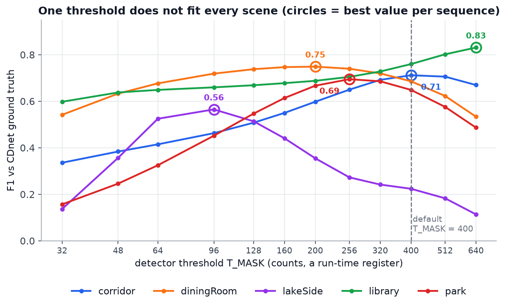

The threshold is a register, and the best value depends on the scene: lakeSide goes from 0.22 at the default to **0.56 at 96**, library from 0.76 to **0.83 at 640**. This is why `run_demo.py` sets `T_MASK` per clip. A single fixed threshold is the main weakness of the detector; an automatic choice is not built ([`docs/results/tmask_sweep.md`](docs/results/tmask_sweep.md)).

### The latency is constant, and the ARM keeps up

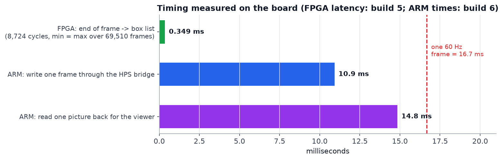

The FPGA datapath has a fixed depth and runs on a fixed tick grid, so the end-of-frame to box-list latency is the same number of cycles every time: **8,724 cycles at 25 MHz = 349 us** (analytic, simulated and measured on the board with the hardware counters, min = max over 69,510 frames). The guarantee covers the FPGA datapath; the delivery of the scene into it (the ARM writes) is outside it ([`docs/latency_spec.md`](docs/latency_spec.md)). The ARM writes a frame in 10.9 ms and reads one back for the viewer in 14.8 ms; the viewer therefore refreshes at about 6 frames per second with two pictures, about 12 with one, while the FPGA itself runs the footage at 30 fps.

### Resources

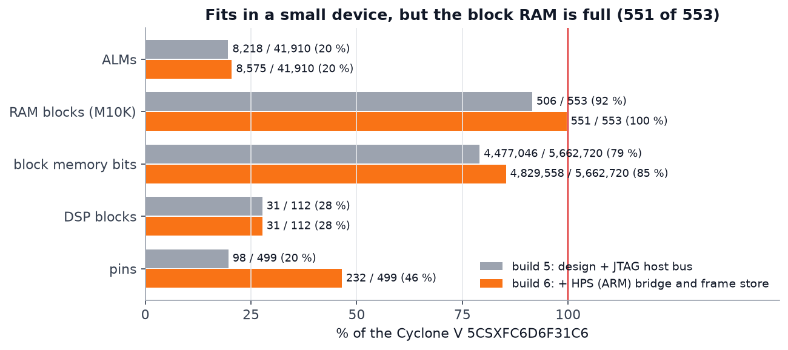

Cyclone V 5CSXFC6D6F31C6. Adding the one-frame scene store and the HPS bridge raised the RAM-block use from 92 % to 100 % (551 of 553). There is no room left for a second frame buffer, which is why the feeder follows the scan. Static timing passes at all corners; the worst setup slack is +1.7 ns in the HPS domain ([`docs/results/resources_soc.md`](docs/results/resources_soc.md)).

### Verification

* The whole design (emulator, NUC, detector, boxes, VGA) matches the Python system model **pixel for pixel** in simulation, and a frame read back from the board matches it in all 76,800 pixels (build 5).
* `scripts/run_regression.py`: 47 groups of self-checking Icarus testbenches and Python tests, all passing.
* Mutation self-test: 121 deliberate RTL faults; 117 were caught on the first full run. The 4 that were not were gaps in the tests (one was a mis-filed and one an equivalent mutant), now closed ([bug log 26](docs/bug_log.md)); the affected tests were re-run, the full 1-hour self-test was not repeated.
* 27 entries in the bug log (bugs found and fixed during the project) are written up with their symptom, cause and lesson in [`docs/bug_log.md`](docs/bug_log.md), including a JTAG hang that only the real board showed and a 40 ms network stall that loopback tests could not.

## Run it yourself

**Live demo** (board booted from the SD card with the SoC image, reachable at 192.168.137.200 by ssh; see [`docs/bringup_3b.md`](docs/bringup_3b.md)):

```
.venv\Scripts\python.exe host\run_demo.py                  # all five clips one after the other, forever
.venv\Scripts\python.exe host\run_demo.py --clip library   # one clip, looped
.venv\Scripts\python.exe host\run_demo.py --clip library,park --view corrected --scale 3
.venv\Scripts\python.exe host\run_demo.py --stop           # stop the board's playback
```

It copies the clips to the board, sets `T_MASK` per scene, resets the NUC and detector for each clip, starts the player on the board and opens the viewer (keys: `v` view, `n` NUC on/off, `e` sensor noise on/off, `o` boxes, `s` save a PNG, `q` quit).

**Simulation, build and tests:**

```
py -3.13 -m venv .venv && .venv\Scripts\pip install numpy scipy scikit-image opencv-python matplotlib pytest pillow
.venv\Scripts\python.exe scripts\run_regression.py                # ~5 min: all RTL testbenches + Python tests
.venv\Scripts\python.exe scripts\run_regression.py --slow         # + full-size system simulations incl. the feed chase (~60 min)
.venv\Scripts\python.exe scripts\run_regression.py --selftest     # injects ~120 RTL faults, the regression must fail on each (~1 h)
.venv\Scripts\python.exe scripts\demo_sim.py --seq library --start 450 --frames 500 --tmask 640   # the expected output without a board
bash scripts/build_quartus.sh quartus/thermal thermal CLOCK_50 u_pll altera_reserved_tck          # build 5 bitstream + STA check (Git Bash)
bash scripts/gen_hps_sys.sh && bash scripts/build_quartus.sh quartus/thermal_soc thermal_soc CLOCK_50 u_pll altera_reserved_tck   # build 6
wsl -d Ubuntu -- bash -lc "cd /mnt/f/Projects/FPGA-Thermal-NUC_Motion/sw && make test && make arm"  # feeder tests, static ARM binary
```

**This page's pictures:** `scripts/make_architecture_svg.py` (diagram), `scripts/make_readme_figures.py` (graphs from the result files and the board captures), `scripts/capture_gifs.py` (GIFs from the board).

### How the GIFs were recorded

`scripts/capture_gifs.py` plays a clip **in lock step**: it plays the warm-up frames, then for each chosen source frame it feeds the frame once, reads the raw and the corrected picture of that same frame and the box list back from the board's capture buffer, and moves on (about 7 frames per second, every 5th source frame). Raw and corrected therefore always show the same source frame. The cost: the detector sees each frame for several display frames, so box sizes can differ somewhat from a free-running 60 Hz demo. The board's capture buffer holds the 8-bit picture the design tone-maps for its own display; the laptop re-windows it before colouring (`--lo-pct`, `--hi-pct`, `--gamma`; defaults 20, 98.5, 0.9), so the contrast is a display choice, not an effect of the NUC.

## Repository

```
rtl/        Verilog-2005 (thermal_top.v / thermal_soc_top.v -> thermal_board.v -> thermal_sys.v -> thermal_core.v ...)
tb/         self-checking Icarus testbenches (vector-driven, bit-exact; thermal_sys_feed_tb.v = the frame feeder protocol)
model/      Python: noise model, scenes, float algorithms, bit-accurate pipeline (2 independent versions), emulator, display
scripts/    studies, vector generators, regression, Quartus build/STA check, clip preparation, figure and GIF scripts
host/       laptop side: run_demo.py, viewer.py (JTAG or --net), feed_clip.py, thermal_net.py, thermal_palette.py, jtag_server.tcl
sw/         ARM side: frame_feeder.c (TCP server, clip player, bench), mock FPGA + tests, Makefile (static ARM build)
quartus/    projects thermal/ (build 5, JTAG) and thermal_soc/ (build 6, HPS), pins, PLL, Platform Designer systems ip/jtag_host, ip/hps_sys
docs/       design, latency spec, noise model, datasets, bug log, board notes, bring-up, results, img/
releases/   archived bitstreams with their source fingerprints
```

Board use (switches, keys, LEDs, HEX pages): header of `rtl/thermal_board.v`; bring-up order and results: [`docs/board_notes.md`](docs/board_notes.md) and [`docs/bringup_3b.md`](docs/bringup_3b.md). The JTAG clock must be 6 MHz for the host bus (`host/viewer.py` sets it; bug log 22).

**Data.** The clips come from CDnet 2014 thermal (`data/cdnet/thermal`, not in the repository): `scripts/prepare_clips.py --seq library --start 720 --frames 400` scales a sequence to 320x240 8-bit and writes the clip and its ground-truth mask. FLIR ADAS thermal was considered for a moving-camera NUC benchmark ([`docs/datasets.md`](docs/datasets.md)).

## Limits and honest notes

* **The sensor noise is simulated.** There is no thermal camera in this project. The emulator adds a realistic-looking but invented noise model to a clean picture so the correction can be scored; how real sensors differ is in [`docs/noise_model.md`](docs/noise_model.md). The footage is real but already 8-bit and contrast-stretched by its camera (CDnet), not radiometric data.
* **The NUC softens the picture** on a static camera, as the graph above shows; it was designed and tested for a moving camera.
* **One threshold does not fit all scenes** (see the `T_MASK` graph); the demo sets it by hand per clip.
* **Block RAM is full** (551 of 553): any new feature that needs memory needs a new trade-off.
* **The live viewer is slow** (6 to 12 frames per second) because every picture is read back over Ethernet; the FPGA itself runs at the full frame rate, and no VGA monitor was used in the recordings.
* **The footage frame rate is assumed to be 30 fps**; I did not verify CDnet's native rate.
* **Board measurements come from one board, one session each:** the latency and the pixel-exact capture are from build 5; the ARM timings, the torn-frame rate and the box scores are from build 6. The box scores are a 50-frame sample per clip, not a benchmark.
* About 1 % of the frames fed from the ARM are flagged torn (the ARM write falls behind the scan, mostly under extra bus load); one such frame can look split for an instant.
